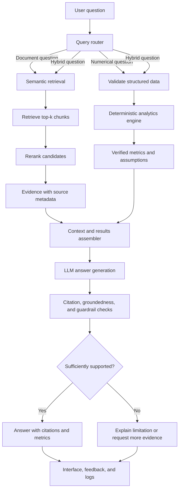
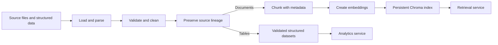
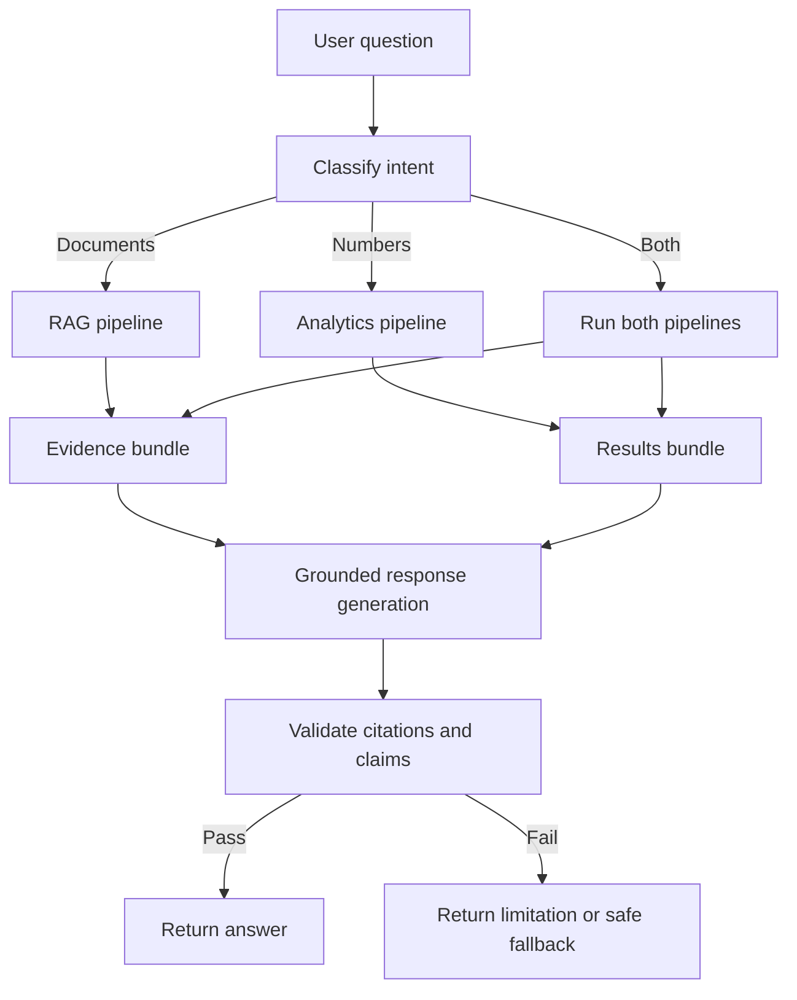
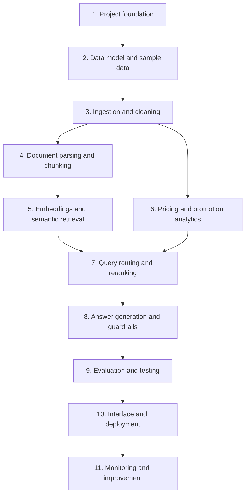

# Domain RAG Copilot: Promotion Effectiveness and Price-Response Analysis

**Project ID:** P7-034\
**Domain:** Pricing, Promotions, Retail, Media & Consumer\
**Project type:** Retrieval-Augmented Generation (RAG) + structured business analytics\
**Build approach:** Incremental, stage-by-stage implementation with Claude\
**Primary language:** Python

This README is the project's **source of truth**. Attach it to every Claude stage prompt so Claude understands the complete goal, the architecture, what has already been built, and how the requested stage fits into the rest of the application.

---

## Build status and setup

Stage 1 (project foundation) is built. Stages 2 to 11 are not started.

Python 3.11 or 3.12. Dependencies are in `pyproject.toml`. Open decisions are in `docs/decisions.md`.

### Setup with Anaconda

```bash
conda create -n rag-copilot python=3.12 -y
conda activate rag-copilot
python -m pip install -e ".[dev]"
```

Without conda, use `python -m venv .venv` and activate it (`source .venv/bin/activate` on macOS/Linux, `.venv\Scripts\activate` on Windows), then run the same pip command.

### Run and test

```bash
python -m domain_rag_copilot
pytest
```

The first command prints a short status report and ends with `status: ok`. The second should show all tests passed. No API key is needed.

### Settings

Copy `.env.example` to `.env` (optional for stage 1) and edit it. Real environment variables override `.env`. The LLM and embedding providers are `unset` until you choose them. Never commit `.env`.

### Folders so far

```text
src/domain_rag_copilot/
  __init__.py       version number
  __main__.py       lets you run: python -m domain_rag_copilot
  cli.py            main(): loads settings, sets up logging, runs the health check
  config.py         Settings class and load_settings()
  logging_setup.py  setup_logging()
  health.py         run_health_check()
tests/unit/         smoke test and config tests
data/sample/        sample data goes here (stage 2)
docs/decisions.md   decisions and open questions
```

---

## 1. Project goal

Build a usable AI assistant for pricing and commercial teams. It should find and explain information in promotion documents, pricing reports, sales data, and competitor observations. It should also calculate supported promotion and price-response metrics from structured data.

The copilot must combine **retrieved source evidence** with **reproducible calculations** when a question needs both. Answers should clearly show where evidence came from, how numerical results were calculated, and when the available data is insufficient to support a conclusion.

### Primary users

Pricing analysts, promotion managers, commercial analysts, and other authorized business users who need to investigate promotion performance and price-response questions.

### Core use cases

1. **Document question:** Find and summarize relevant passages in pricing or promotion documents, with source citations.
2. **Numerical question:** Calculate metrics from validated sales, price, and promotion data using deterministic Python logic.
3. **Combined question:** Retrieve source evidence and calculate relevant metrics, then present both in one grounded answer.
4. **Unsupported question:** Explain what data or evidence is missing rather than inventing a result.

### Example question

> Did the 10% discount improve sales, and what evidence supports the conclusion?

To answer, the system should retrieve relevant promotion context, calculate sales results against an explicitly defined baseline or comparison, cite the sources used, and state the limitations. An increase in sales during a promotion does **not** by itself prove that the promotion caused the increase.

---

## 2. Scope and success criteria

### Minimum complete product

The completed product must include:

- Data loading, schema checks, cleaning, and source lineage.
- Document parsing, chunking, metadata, and citation-preserving retrieval.
- Sentence embeddings and a persistent Chroma vector store.
- Semantic retrieval and a reranking step or a documented, tested fallback if reranking is not available.
- Deterministic promotion and price-response analytics.
- Query routing for document, numerical, and hybrid questions.
- LLM answer generation grounded in retrieved evidence and verified calculations.
- Citation checks, groundedness guardrails, and a safe response when evidence is inadequate.
- Automated tests and an evaluation suite.
- A usable interface and application endpoint(s), with clear run and deployment instructions.
- Basic logging/monitoring, cost and latency visibility where feasible, human feedback, and a responsible-AI review checklist.

### Success measures

Use task-appropriate measures and report the test set and method behind each result:

- **Classification:** Accuracy and precision/recall/F1 where a labeled classification task exists.
- **Retrieval:** Recall@K and Mean Reciprocal Rank (MRR).
- **Answers:** Groundedness, answer relevance, citation correctness, and refusal quality.
- **Analytics:** Correctness against hand-calculated or independently verified test cases.
- **Operations:** Latency, failures, and estimated model/vector-store cost.

Do not claim a target has been met without running the relevant evaluation and reporting the actual result. Establish baselines before setting numerical targets.

### Out of scope for the initial version

- Autonomous price changes, promotion launches, or other business actions.
- Claims of causal lift without an appropriate experimental or causal method.
- Untraceable answers that cannot identify their supporting evidence.
- Production-scale multi-tenant access control unless it is explicitly added to the project scope.

---

## 3. Architecture at a glance

The system has two main processing paths, joined when a question needs both:

- **RAG path:** Retrieve relevant document chunks, rerank them, and preserve source metadata for citations.
- **Analytics path:** Validate structured data and calculate metrics with ordinary Python code. The LLM must not be the calculator of record.

The query router selects the document path, analytics path, or both. Answer generation combines only relevant retrieved evidence and verified results. A final validation layer checks citation support and guardrails before returning the response.



### Request control flow

1. Receive a question and validate the request.
2. Classify it as document-focused, numerical, hybrid, or unsupported/out of scope.
3. Run only the processing path(s) needed for the question.
4. Collect retrieved evidence, source metadata, calculated metrics, and stated assumptions.
5. Generate an answer using that material as the permitted evidence.
6. Check that citations map to real retrieved sources and that numerical claims match the analytics output.
7. Return the answer, citations, calculations/definitions where useful, and limitations.
8. Log operational metadata and optional user feedback without exposing secrets or unnecessary sensitive data.

**Important control rule:** If the system cannot retrieve sufficient evidence or cannot calculate a requested metric from valid inputs, it must communicate that limitation. It must not silently fabricate a citation, dataset value, calculation, or business conclusion.

---

## 4. Data and analytical rules

The initial project should support the following input categories. Use synthetic sample data for development if real, authorized data is not yet available. Clearly label synthetic data so it cannot be mistaken for real business evidence.

### Structured inputs

| Input | Typical fields | Purpose |
| --- | --- | --- |
| Products | `product_id` or `sku`, name, category | Identify products consistently |
| Prices | product/SKU, date, price, currency, region/channel where relevant | Track regular and observed prices |
| Promotions | `promotion_id`, product/SKU, start/end dates, discount type/value, region/channel | Define the promotion being analyzed |
| Sales | date, product/SKU, units, revenue, optional cost and dimensions | Measure observed performance |
| Competitor observations | competitor/product, observed price, observation date, source | Provide dated and traceable competitor context |

Finalize exact schemas and required/optional fields in Stage 2. Validate types, ranges, keys, date formats, duplicates, missing values, and join consistency. Do not silently invent missing business values.

### Documents and source metadata

Support appropriate text-based business documents first. Every chunk must retain enough metadata to trace it back to its source. Depending on the source, metadata may include:

- `document_id`, `source_name`, `source_type`, and source location or reference.
- Document title, publication/effective date, and version when available.
- Product/SKU, promotion ID, region, channel, or category when applicable.
- Chunk ID and any page/section reference available from the loader.

Preserve original source identity through parsing, chunking, retrieval, reranking, and the final citation. Never cite a chunk with source metadata that was lost or inferred without evidence.

### Analytical rules

- Define the baseline/comparison period and include it in the result.
- Discount depth, sales change, promotion uplift, and price-response calculations must have documented formulas and assumptions.
- A simple uplift calculation may be expressed as `(observed value - baseline value) / baseline value × 100`, but only after the baseline has been defined and validated; handle a zero or missing baseline explicitly.
- A simple price elasticity estimate may compare percentage change in quantity with percentage change in price, but the method, time window, and limitations must be stated. Handle zero price changes and insufficient observations safely.
- Separate descriptive comparisons from causal claims. Do not label an observed increase as incremental or caused by a promotion unless the chosen methodology supports that claim.
- Keep calculation logic in tested Python functions. Let the LLM explain their outputs; do not ask the LLM to invent the underlying numbers.
- When results depend on missing data, seasonality, stockouts, channel/region differences, or other confounders, disclose relevant limitations.

---

## 5. Recommended initial technology choices

Use a simple, modular stack and avoid adding technologies without a demonstrated need.

| Area | Initial choice | Notes |
| --- | --- | --- |
| Language | Python | Main application and analytics code |
| RAG orchestration | LangChain | Keep orchestration separate from business logic |
| Vector store | Chroma | Persistent local vector index for the initial implementation |
| Data processing | pandas and standard Python | Structured data cleaning and deterministic calculations |
| Data validation | Pydantic and/or explicit schema checks | Validate inputs and application contracts |
| API | FastAPI | Application endpoints and health check |
| User interface | Streamlit | Simple interactive user-facing interface |
| Testing | pytest | Unit, integration, and evaluation tests |

Select an embedding model and an LLM provider during the foundation stage. Put provider/model settings in configuration and secrets in environment variables; never hardcode API keys in source code. Keep provider-dependent code isolated so a model can be changed without rewriting the analytics logic.

The initial version should prefer straightforward, testable components over elaborate agent frameworks. Add complexity only when a requirement or evaluation result justifies it.

---

## 6. End-to-end data flows

### A. Indexing and ingestion flow



### B. Question-answering flow



---

## 7. Development stages and handoff contracts

Build in the order below. Each stage has an output, depends on earlier stages, and must be verified before moving ahead. Later stages may add to earlier modules, but should not casually replace their contracts or rewrite unrelated parts of the project.



### Stage 1 — Project foundation

**Purpose:** Establish a runnable, maintainable project skeleton before implementing the business features.

**Build:** Repository/folder layout, Python environment instructions, dependency file, configuration handling, `.env.example`, `.gitignore`, logging basics, application entry points, and a minimal test setup. Record chosen Python version, model/embedding provider settings, and setup decisions.

**Expected output:** The project installs and starts using documented commands, configuration is separate from code, and no credentials are committed.

**Completion gate:** A clean setup works; a basic smoke test passes; commands and decisions are documented. Do not build the full RAG pipeline in this stage.

### Stage 2 — Data model and sample data

**Purpose:** Define consistent contracts for documents and commercial data before ingestion and analytics rely on them.

**Build:** Schemas, field definitions, key relationships, data dictionary, validation expectations, and a small representative sample dataset. Include realistic examples of promotions, prices, sales, and competitor observations. Clearly label generated data as synthetic.

**Expected output:** Documented schemas and sample data that can exercise document, numeric, and hybrid questions.

**Completion gate:** Required columns, types, keys, dates, units/currency assumptions, and join relationships are documented and validated by tests.

### Stage 3 — Data ingestion and cleaning

**Purpose:** Load sources reliably and turn raw inputs into validated, traceable data.

**Build:** Loaders, schema validation, type/date normalization, duplicate and missing-value handling, data-quality reporting, consistent errors, and source lineage. Separate document input handling from structured-table handling while sharing configuration and error conventions.

**Expected output:** Reusable ingestion functions and a repeatable process that produces validated document inputs and structured datasets.

**Completion gate:** Valid inputs pass; malformed or incomplete inputs produce understandable errors or quality warnings; source identifiers remain attached; tests cover important failure cases.

### Stage 4 — Document processing and chunking

**Purpose:** Convert source documents into retrievable passages without losing their origin.

**Build:** Document parsing, normalized text, configurable chunk size and overlap, useful document/chunk metadata, stable chunk identifiers where feasible, and tests for empty or unsupported content. Start with the document formats actually required by the supplied inputs.

**Expected output:** A collection of well-formed chunks with provenance metadata, ready for embedding.

**Completion gate:** Chunk boundaries are reasonable, metadata survives processing, duplicate/empty content is handled, and citations can point back to original source information.

### Stage 5 — Embeddings and semantic retrieval

**Purpose:** Make document chunks searchable by meaning rather than exact keyword matching alone.

**Build:** Embedding integration, persistent Chroma collection, indexing/upsert behavior, query embeddings, top-k retrieval, relevant metadata filters where needed, and retrieval tests. Make model and storage configuration explicit. Add or prepare retrieval metrics for the evaluation stage.

**Expected output:** A working retrieval service that accepts a question and returns ranked candidate chunks with scores and source metadata.

**Completion gate:** Indexing and search run end to end; persistence and re-indexing behavior are tested; results retain valid provenance; a small set of sample queries returns relevant evidence.

### Stage 6 — Pricing and promotion analytics

**Purpose:** Produce numerical answers from structured data using deterministic, testable logic.

**Build:** Clean interfaces and unit-tested functions for applicable metrics such as discount depth, sales change versus a defined baseline, promotion uplift, and simple price-response/elasticity estimates. Validate date windows and product/promotion joins; handle zero denominators, missing periods, and insufficient observations; return formulas, assumptions, and limitations alongside values.

**Expected output:** An analytics service that returns structured results rather than prose alone.

**Completion gate:** Known test cases match hand-calculated expected values, edge cases are handled safely, and each metric has a documented definition. No metric should imply causality unless its methodology warrants it.

### Stage 7 — Query routing, retrieval improvement, and reranking

**Purpose:** Direct questions to the appropriate processing path and improve evidence selection.

**Build:** A router for document, numerical, hybrid, and unsupported/out-of-scope requests; structured routing outputs; integration with Stage 5 retrieval and Stage 6 analytics; a reranker or an explicit tested fallback; and clear error handling when one path cannot provide results.

**Expected output:** One orchestration entry point that selects the correct path or paths and returns evidence/results in predictable structures.

**Completion gate:** Labeled examples correctly exercise all major routes; a hybrid query can collect both retrieved evidence and numerical results; failures do not silently become fabricated answers.

### Stage 8 — RAG answer generation and guardrails

**Purpose:** Turn collected evidence and validated calculations into clear, supported responses.

**Build:** Prompt templates, context assembly, LLM invocation, answer structure, source citations, numerical-result references, groundedness and citation checks, unsupported-question handling, and basic defenses against instructions embedded in retrieved documents. Keep prompts and generation logic separate from the analytics implementation.

**Expected output:** Answers that distinguish sourced facts, calculated results, assumptions, and limitations.

**Completion gate:** Citations resolve to retrieved source records; answer claims are supported; numerical claims match analytics output; insufficient evidence triggers a clear limitation or refusal instead of invention.

### Stage 9 — Evaluation and testing

**Purpose:** Measure quality systematically rather than relying only on a few successful demonstrations.

**Build:** A versioned evaluation set containing document, numerical, hybrid, unanswerable, and edge-case questions; expected sources and known numerical results; tests for retrieval Recall@K/MRR, answer groundedness, citation correctness, relevance, refusal quality, and analytics correctness; and measurement of latency/cost where available.

**Expected output:** Repeatable evaluation commands and a concise report showing measured results, failures, and known limitations.

**Completion gate:** Tests run reproducibly; results are reported honestly; critical errors have tests or tracked fixes; thresholds, if used, are documented and justified.

### Stage 10 — Interface, API, and deployment

**Purpose:** Make the integrated application usable outside isolated development scripts.

**Build:** FastAPI endpoints, request/response schemas, a Streamlit interface, input validation, display of citations and calculations, useful error messages, configuration for local and deployed environments, health checks, and deployment instructions. Only expose the endpoints and features actually needed by the application.

**Expected output:** A user can enter a question, receive a grounded answer with supporting citations/results, and understand failures or limitations.

**Completion gate:** A documented clean-start procedure works; API and UI smoke tests pass; secrets are configuration-based; the deployed app, if deployment is configured, is tested end to end.

### Stage 11 — Monitoring, feedback, and responsible-AI review

**Purpose:** Make the application maintainable and transparent after deployment.

**Build:** Structured operational logs, error and latency tracking, cost estimates where feasible, user feedback capture, a controlled way to refresh/re-index data, review procedures for poor answers, and a responsible-AI checklist covering price discrimination, transparency, consent, data lineage, failure modes, and human oversight.

**Expected output:** Clear maintenance instructions, basic visibility into application health, and an actionable review process.

**Completion gate:** Logs do not expose secrets; operational failures can be diagnosed; data refresh is documented; the responsible-AI checklist and known limitations are recorded.

---

## 8. Suggested repository structure

Claude may refine this structure when necessary, but keep responsibilities separated and document meaningful deviations.

```text
domain-rag-copilot/
├── README.md
├── requirements.txt              # or pyproject.toml; choose one primary dependency workflow
├── .env.example                  # variable names and safe placeholders only
├── .gitignore
├── app.py                        # Streamlit entry point, if used
├── src/
│   └── domain_rag_copilot/
│       ├── __init__.py
│       ├── config.py
│       ├── api/
│       │   └── main.py            # FastAPI entry point
│       ├── schemas/
│       ├── ingestion/
│       ├── retrieval/
│       ├── analytics/
│       ├── routing/
│       ├── generation/
│       ├── evaluation/
│       └── monitoring/
├── data/
│   ├── sample/                    # synthetic/sample inputs only
│   └── README.md                  # data dictionary and data handling notes
├── tests/
│   ├── unit/
│   ├── integration/
│   └── evaluation/
├── scripts/
└── docs/
    ├── architecture.md            # optional if details outgrow this README
    └── decisions.md               # important technical decisions and rationale
```

Do not create empty modules just to match the diagram. Add files when a stage needs them. Keep application code, UI code, data, tests, configuration, and evaluation assets distinguishable. Do not commit real confidential business data, API keys, model credentials, or generated local vector-store artifacts unless the repository policy explicitly allows them.

---

## 9. Cross-stage engineering rules

These rules apply to all stages.

 1. **Preserve the architecture:** Reuse earlier modules and contracts instead of rebuilding the application independently at every stage.
 2. **Keep responsibilities separated:** Ingestion loads/validates; retrieval finds evidence; analytics calculates; routing orchestrates; generation explains; guardrails validate; the interface presents.
 3. **Prefer small, testable functions:** Avoid placing the entire application in one file or one oversized function.
 4. **Use explicit contracts:** Define schemas for inputs and outputs that cross module boundaries. Do not pass ambiguous free-form objects when a clear model is practical.
 5. **Make configuration explicit:** Use environment variables and configuration files for secrets and provider settings. Commit placeholders only, never secrets.
 6. **Preserve provenance:** Carry source/chunk identifiers and metadata until the response is presented and evaluated.
 7. **Make failures safe and visible:** Validate inputs; handle missing data, unavailable providers, empty retrieval, malformed responses, and zero denominators. Do not silently substitute invented defaults.
 8. **Test incrementally:** Add or update tests with each feature. A later stage does not excuse an earlier broken contract.
 9. **Avoid needless dependencies:** Add a library only when it materially supports a requirement; explain why it is needed.
10. **Keep the project runnable:** Update setup instructions when commands, modules, environment variables, or dependencies change.
11. **Do not overclaim:** Report only tests and evaluations that actually ran. Separate observed facts from assumptions and causal claims.
12. **Explain changes:** When changing an existing contract or architecture decision, state what changed, why it was necessary, and which earlier stages are affected.

---

## 10. How to use this README with Claude, stage by stage

For each stage, attach this README and provide only the prompt for the stage you are currently building. Use the same repository/workspace throughout the project so Claude can inspect and extend the actual files instead of recreating them from descriptions.

### Required working behavior for Claude

For the requested stage, Claude should:

1. Read this README and inspect the existing project files before changing code.
2. Briefly state the stage goal, prerequisites, files expected to change, and how the stage connects to the architecture.
3. Implement only the current stage. Do not prematurely implement later stages or rewrite unrelated working modules.
4. Provide complete file contents or focused patches that can be applied directly; identify the exact path for every file created or changed.
5. Explain important decisions in beginner-friendly language, including what each significant module does and how data flows through it.
6. Provide exact environment/setup/run/test commands for the current operating system or ask for the OS only if it materially changes the commands.
7. Run available checks when tool access permits. Clearly separate checks that were run from checks the user must run locally; never claim a test passed without evidence.
8. End with the stage's completion checklist, known limitations, changed files, commands/results, and a short **handoff summary for the next stage**.
9. Stop after the current stage. Wait for the user to confirm the stage works before implementing the next stage.

### Stage completion checklist

Before advancing, confirm the applicable items:

- [ ] Required output for the current stage exists.

- [ ] The app or module runs as expected for this stage.

- [ ] Tests or manual verification steps are documented and have been executed where possible.

- [ ] New configuration variables and dependencies are documented.

- [ ] Existing module contracts and earlier working functionality still hold.

- [ ] Limitations or unresolved errors are explicitly listed.

- [ ] A concise handoff summary is available for the next stage.

### If Claude lacks the latest project state

Ask it to inspect the current files and the last stage's handoff summary before editing. If the workspace does not contain the previous stage's changes, Claude must identify that gap rather than assuming the code exists. Do not restart the whole project unless explicitly instructed.

### Conflict rule

This README defines the overall project goal, architecture, stage order, and cross-stage quality rules. The current stage prompt defines the immediate scope. A stage prompt must not silently contradict the README or discard earlier working behavior. If a genuine conflict or a necessary architecture change occurs, Claude must point it out and explain the impact before making a broad change.

---

## 11. Final definition of done

The project is complete when a user can ask a supported document, numerical, or hybrid pricing question and the application:

- Routes the question to the correct processing path.
- Retrieves relevant source passages and/or calculates metrics from validated data.
- Produces a clear response that uses only supported evidence and verified numerical outputs.
- Provides accurate, traceable citations for document-based claims.
- Explains material assumptions, missing data, and analytical limitations.
- Safely handles unsupported questions, errors, and insufficient evidence.
- Passes the documented tests and has a repeatable evaluation report.
- Runs through the documented interface and deployment workflow.
- Includes basic operational monitoring, feedback, data-lineage notes, and responsible-AI review guidance.

## 12. Project build sequence summary

**Foundation → Data model → Ingestion and cleaning → Document chunking → Embeddings and retrieval → Structured analytics → Routing and reranking → Answer generation and guardrails → Evaluation → Interface and deployment → Monitoring and improvement.**

Build one stage at a time, verify it, record its handoff summary, and then move forward. The goal is not merely to generate code; it is to build a coherent, testable, understandable application whose parts work together.